# BifroSSH

[](https://github.com/AalmanSadath/BifroSSH/actions/workflows/ci.yml)
[](https://github.com/AalmanSadath/BifroSSH/releases/latest)
[](LICENSE)

A desktop SSH client for Linux and Windows. Tabbed terminal, SFTP, jump-host
chains, port forwarding and key management in one window.

Most SSH clients that save your servers leave the list of them sitting in
plaintext next to the encrypted passwords. BifroSSH encrypts the whole store,
including hostnames, usernames, jump chains, forwarding rules, saved commands
and keys, under one master key held in the system keyring, or behind a
passphrase, or both. Copying your home directory does not copy the key with it.

Host keys are verified before authentication, the same way OpenSSH does it.
Keys can stay in your ssh-agent and never enter the app at all, which is how
PIV smartcards and YubiKeys work here.

Built in Rust with Tauri 2, russh and xterm.js. Flatpak, `.deb` and `.rpm` on
Linux, NSIS installer on Windows. macOS is not supported.

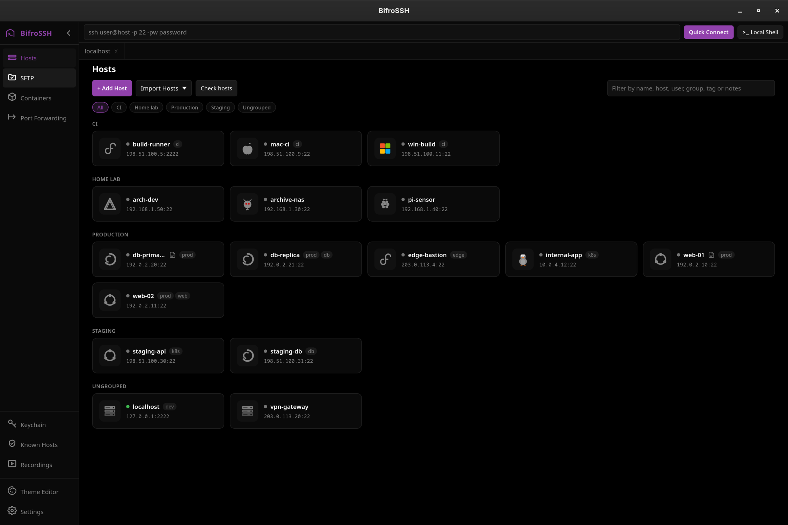

## Install

### Linux

All three are served from [bifrossh.aalman.dev](https://bifrossh.aalman.dev), signed with
one key, and update with the rest of your system.

#### Flatpak

```bash
flatpak remote-add --if-not-exists flathub https://dl.flathub.org/repo/flathub.flatpakrepo
flatpak remote-add --if-not-exists bifrossh https://bifrossh.aalman.dev/bifrossh.flatpakrepo
flatpak install bifrossh io.github.aalmansadath.bifrossh
flatpak run io.github.aalmansadath.bifrossh
```

Ubuntu needs a user-mode install to avoid FUSE permission issues, so add `--user` to each command above.

```bash
flatpak update io.github.aalmansadath.bifrossh     # update
flatpak uninstall io.github.aalmansadath.bifrossh  # remove
flatpak remote-delete bifrossh                     # and drop the remote
```

#### Debian, Ubuntu

```bash
curl -fsSL https://bifrossh.aalman.dev/bifrossh.sources | sudo tee /etc/apt/sources.list.d/bifrossh.sources
sudo apt update
sudo apt install bifrossh
```

The `.sources` file carries the signing key itself, so there is nothing to put
in `/etc/apt/keyrings` first, and the key is trusted for this repository only.

#### Fedora, RHEL

```bash
sudo dnf config-manager addrepo --from-repofile=https://bifrossh.aalman.dev/bifrossh.repo
sudo dnf install bifrossh
```

On dnf 4 (RHEL 9, Fedora 40 and older) the first line is
`sudo dnf config-manager --add-repo https://bifrossh.aalman.dev/bifrossh.repo`.
dnf asks once to trust the key; its fingerprint is
`5B97 1E88 CAAA EDBB 0358 6DD1 49EF F0E4 91C7 7412`.

Both install the binary as `/usr/bin/bifrossh`, and removal is
`sudo apt remove bifrossh` or `sudo dnf remove bifrossh`. Neither touches
`~/.local/share/bifrossh`, which is where your hosts and keys live.

They are built on Ubuntu 24.04, so they need glibc 2.39 or newer. An older
distribution will refuse to install them and should use the Flatpak, which
carries its own runtime and does not care.

The `.deb` and `.rpm` are also on the
[latest release](https://github.com/AalmanSadath/BifroSSH/releases/latest),
for a machine you would rather not add a repository to. Installed that way they
do not update.

#### Going back a version

The last ten releases stay in each repository.

```bash
# Flatpak: list them, then install one by its commit
flatpak remote-info --log bifrossh io.github.aalmansadath.bifrossh
flatpak update --commit=COMMIT io.github.aalmansadath.bifrossh
flatpak mask io.github.aalmansadath.bifrossh     # optional: stay there until `flatpak mask --remove`

# apt
apt list -a bifrossh
sudo apt install bifrossh=VERSION
sudo apt-mark hold bifrossh                     # optional: stay there until `apt-mark unhold`

# dnf
sudo dnf downgrade bifrossh
```

### Windows

Download `BifroSSH_x.y.z_x64-setup.exe` from the [latest release](https://github.com/AalmanSadath/BifroSSH/releases/latest) and run it. It installs for the current user only, so there is no administrator prompt, and it uninstalls from Settings > Apps.

Uninstalling leaves `%APPDATA%\BifroSSH` alone unless you tick **Delete the application data**, which asks once more before removing it, because nothing else holds a copy of your keys. An update never removes it.

The installer is not code signed, so SmartScreen shows **"Windows protected your PC"** on first run. **More info** then **Run anyway** gets past it. Signing needs a certificate that has to be bought and renewed; there is no way to make that warning go away without one.

Windows 10 1803 or later. WebView2 is already present on Windows 11 and on current Windows 10; the installer fetches it if it is not.

## Features

**Hosts.** Add them by hand, or import them from `~/.ssh/config` (following `Include`, and bringing `ProxyJump`, `ProxyCommand`, `IdentityFile` and `CertificateFile` along), from PuTTY, from MobaXterm or from a Termius CSV export. Per-host username, key or password, port, OS tag and default theme, or shared identities reused across servers. A host can also carry its own connect timeout, `TERM`, environment variables, a command to type once logged in, and notes. Sort hosts into groups, tag them, and filter the list by any of it (`#tag` matches one tag exactly). Select several to connect, tag, move or remove them together. **Check hosts** times a plain TCP connect to each one, without logging in, and shows the latency on its card. The bar at the top of the list connects to anything typed as `user@host -p 22`, saved or not.

**Jump hosts.** Reach a server through a bastion, the same as ssh's `ProxyJump`, chained as deep as you need. Each hop authenticates with its own credentials and has its own host key verified, so a bastion on an agent key and a target on a password work together unchanged. Terminal, SFTP and tunnels all follow the chain. A host reached some other way can use `ProxyCommand` instead, with `%h`, `%p`, `%r` and `%n`, for `cloudflared`, AWS SSM, `nc` through a proxy and the like. Inside the Flatpak that command runs on the host system, where those tools are installed.

**Terminal.** xterm.js with configurable scrollback (10 000 lines unless changed), font and cursor, and per-session colours. **Ctrl+Shift+F** searches the scrollback with match highlighting, case, whole-word and regex options. Selecting text copies it and right-click pastes. Links open in the browser, and an absolute path printed by a remote command opens in the SFTP panel when clicked. Each tab zooms on its own, with Ctrl+=, Ctrl+- and Ctrl+0 or Ctrl+wheel. Sixel and iTerm2 images (`imgcat`, `chafa`) display inline, and ZMODEM works: `sz` on the host saves files here, `rz` sends them there. Highlight rules colour matching output, such as errors in red. Commands are remembered per host and offered back as you type, the way fish does it; a command typed with a leading space is not kept. With the shell integration snippet installed (bash or zsh, copied from Settings), each tab shows how long the current command has been running or how the last one exited. On Linux hosts a bar under the terminal can show CPU, memory, disk, network and load.

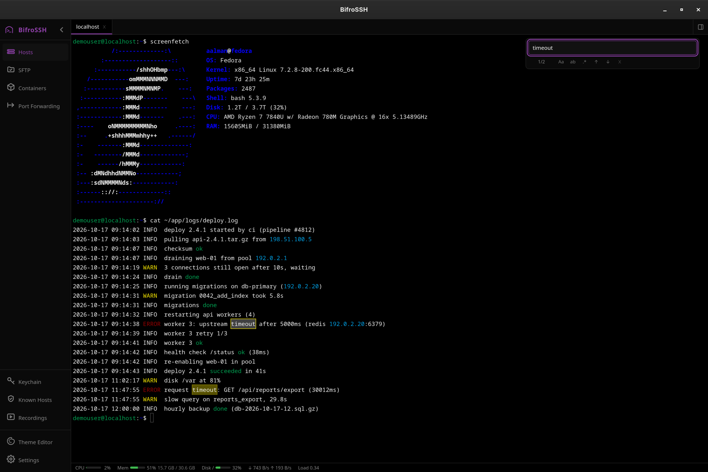

**Tabs and windows.** Any number of sessions in tabs, each independent. Rename a tab, duplicate it, or drag it onto the terminal to show up to four side by side. A tab can move into a window of its own and come back; closing that window brings it back too. Mark tabs for broadcast and what you type goes to all of them at once. A tab's scrollback can be copied or saved as text. A local shell opens in a tab as well: your login shell on Linux, PowerShell on Windows, or whatever program you set. Tabs open at exit reopen and reconnect at the next launch, under the names you gave them, unless that is turned off.

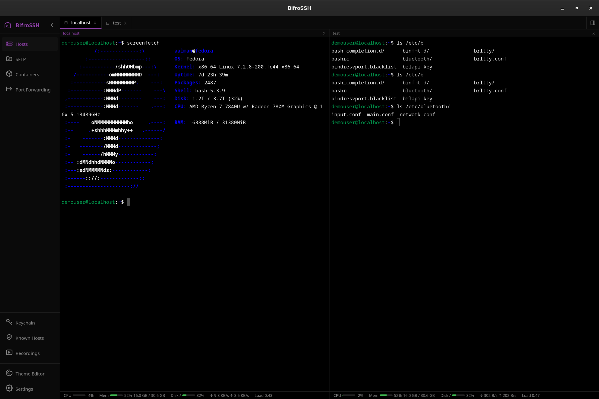

**Keyboard.** Ctrl+Tab and Ctrl+Shift+Tab (or Ctrl+PageDown and Ctrl+PageUp) move between tabs, Ctrl+1 to Ctrl+8 pick one and Ctrl+9 picks the last. Ctrl+Shift+T duplicates a tab, Ctrl+Shift+W closes it, Ctrl+Shift+N opens a local shell and Ctrl+Shift+B toggles broadcast. Ctrl+Shift+C and Ctrl+Shift+V copy and paste. Every shortcut can be rebound or turned off in Settings, which says when a key is already taken.

**Command palette.** **Ctrl+K** searches open tabs, hosts, SFTP to any host, codeprints, every panel and settings page, and actions such as broadcast, recording, moving a tab to its own window and locking the vault.

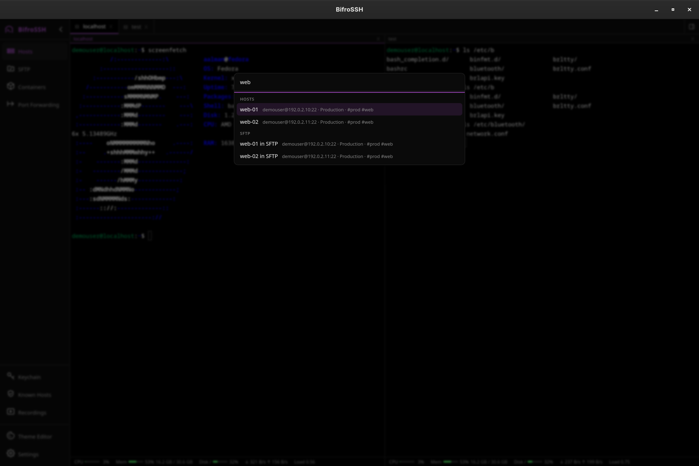

**SFTP.** Browse, upload, download, rename and delete, including whole folders in either direction or directly between two remote servers, with per-file progress. A folder can also be copied as one compressed stream rather than file by file; between two servers it never passes through this computer's disk. Two folders can be compared by size and SHA-256 before anything is copied. Change permissions and owner, bookmark folders, or open a remote file in its usual application and have every save uploaded back. A file already at the destination asks whether to overwrite, skip or keep both. A transfer that stops can be resumed from where it got to, and the resumed file is checked against the original afterwards; Settings can have every transfer checked that way, which needs `sha256sum` on the server. Files dragged in from the file manager upload (Linux only), and the lists work from the keyboard, with a filter that starts as you type.

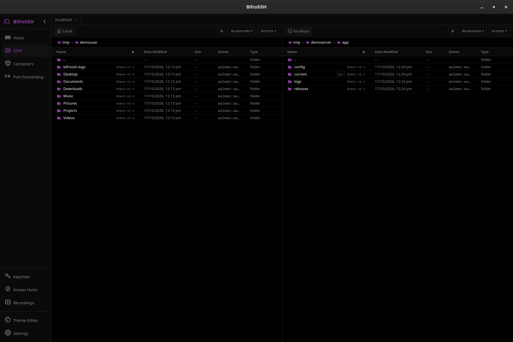

**SSH keys.** Generate Ed25519, ECDSA (P-256) and RSA (2048 or 4096) keys in the app, or import existing ones, PuTTY `.ppk` files included. Private keys are stored encrypted and never written to disk in the clear. A key can instead stay in its file and be read from there, which is how keys named in `~/.ssh/config` arrive. OpenSSH user certificates attach to their key with the expiry shown, and a `-cert.pub` beside a key file is picked up by itself.

**ssh-agent.** Authenticate with keys held by a running agent instead of importing them, so the key never enters the app. This is how to use PIV smartcards and YubiKeys, whose keys cannot be exported. On Linux the agent named by `SSH_AUTH_SOCK`; on Windows the OpenSSH agent service over its named pipe, or any agent that advertises its own pipe through `SSH_AUTH_SOCK`. Pageant is not supported, and neither are FIDO keys (`ed25519-sk`, `ecdsa-sk`) yet. The Keychain lists the keys the agent holds, and an identity can be pinned to one of them. A host can also be set to forward the agent, the same as `ssh -A`, so programs there can use your keys without the keys leaving this machine; that also lets anyone with root there use them while the session is open, so it is off unless you turn it on for that host.

**Two-factor and keyboard-interactive.** Servers that ask challenge questions at login work, including PAM setups with `PasswordAuthentication` off and providers like Duo and TOTP apps. Where the server offers a choice of factors they appear as buttons. Password and key logins fall back to this automatically.

**Port forwarding.** Local (`-L`), remote (`-R`) and dynamic SOCKS5 (`-D`) tunnels, created with a wizard and started from a card. Several can run at once, each on the address you bind it to. A tunnel can start when BifroSSH opens or when you connect to its host, and one started that way restarts by itself if it drops. The SOCKS5 server handles CONNECT only, without authentication.

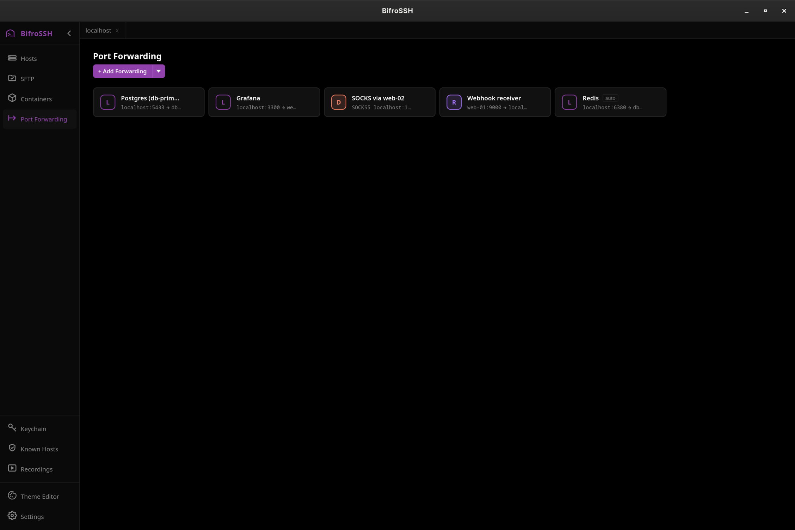

**X11 forwarding.** A host can be set to forward X11, the same as `ssh -X`, so graphical programs started there open their windows here. The host needs `X11Forwarding yes` and `xauth` installed. The server is handed a cookie made for the session rather than your real one, but while the session is open a program there can read your display's keyboard and screen like any other X client, so it is off unless you turn it on for that host. On Windows, run an X server such as VcXsrv first.

**Containers.** Pick a host to list its Docker and Podman containers, start, stop or restart them, and open a shell in one or follow its logs in a tab. With sudo, root's containers are listed too.

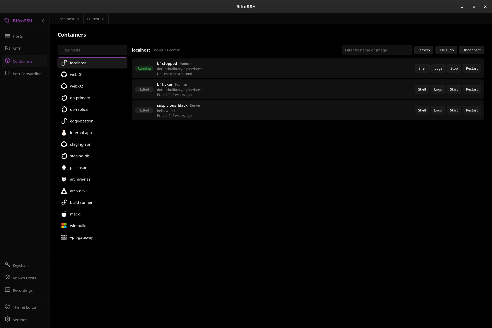

**Recording and logging.** Record a session as an asciicast and play it back in the app at 1×, 2× or 4× with a seek bar, or in any asciinema player. Or log a session's raw output to a file, from the tab's menu or for every session to a host.

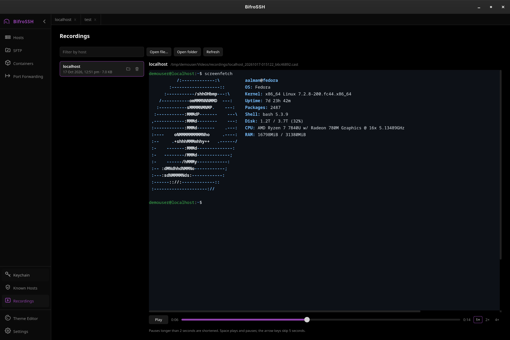

**Codeprints.** Named commands you keep around, pasted into the prompt to edit or run outright, shared across every session. A codeprint can hold `{{name}}` or `{{name:default}}` placeholders, filled in each time it is used.

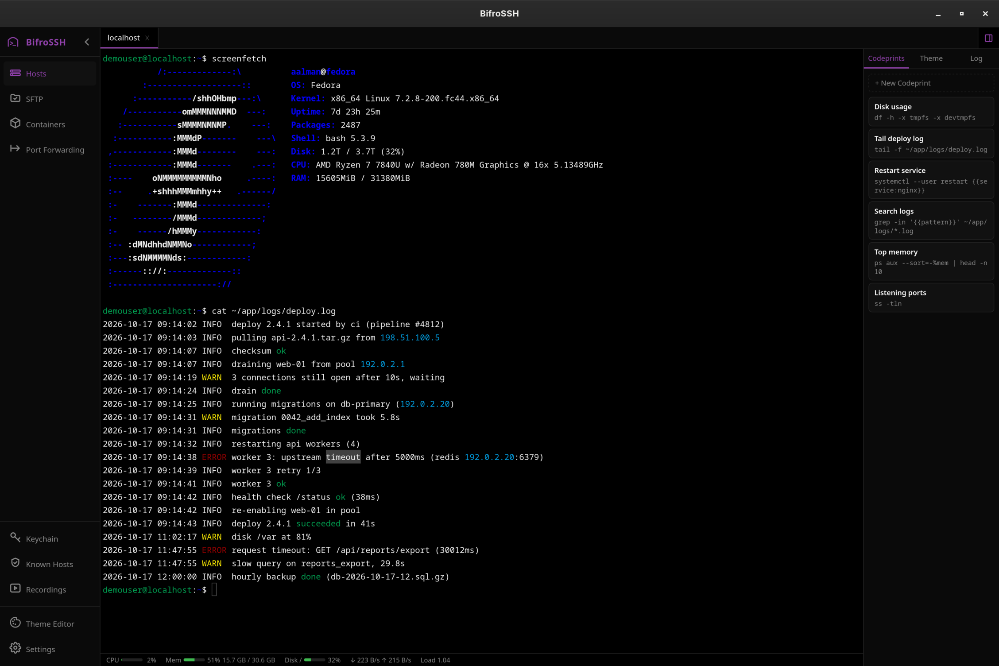

**Themes.** Dark and light out of the box, plus an editor for every colour including all 16 ANSI slots. Apply a theme to one session without changing the host's default. The app itself follows the desktop's light or dark mode, or is set to dark, light or AMOLED black, with an accent colour of your own or the desktop's.

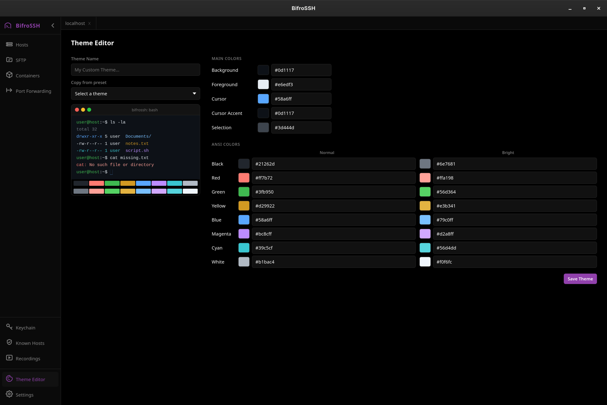

**Export and import.** Move a whole setup to another machine, or keep a backup. Writes one encrypted `.bfx` file holding hosts, identities, keys, tunnels, codeprints, themes, settings and known hosts, with passwords and private keys left out if you prefer. Importing shows what the file holds and lets you pick which parts to bring in. It only ever adds: anything already there is kept and reported as skipped, so the same file can be imported twice safely. Settings are the one exception, and replace yours if you tick them.

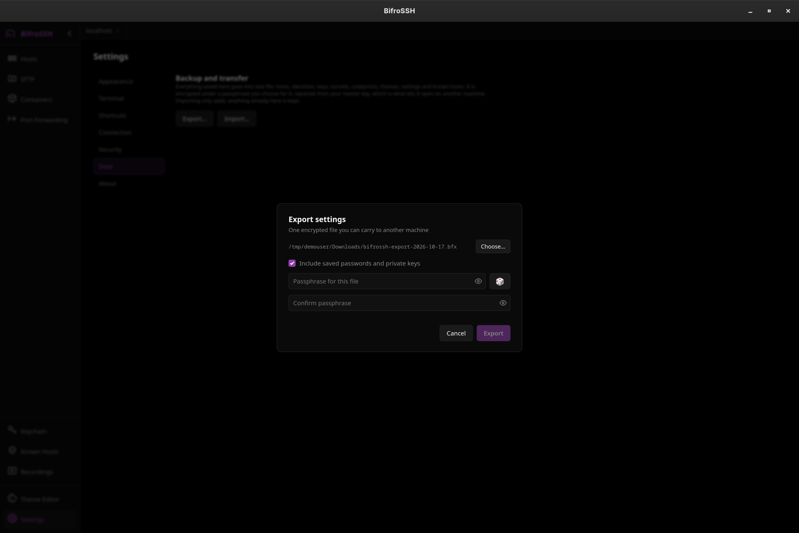

**Connection reliability.** Configurable keepalives stop idle sessions being dropped by NAT and firewall timers, and every connection keeps a log of how it was established, still readable after the fact. A session that drops keeps its tab and scrollback and reconnects by itself, first after 5 seconds and then waiting twice as long each time up to a minute, five tries unless set otherwise. Enter in the tab tries again at once.

**Updates.** At launch BifroSSH asks GitHub whether a newer release exists, one request with nothing downloaded, and says so in the sidebar. Settings can turn that off, and has **Check now**.

## Security

**Host keys are verified** before authenticating, the same way OpenSSH does. Three policies are available, **Ask** (default), **Accept new** and **Strict**. Under Ask an unknown server shows its fingerprint for you to trust and save, or to connect to once without saving. A server presenting a different key than the one stored is what a man-in-the-middle looks like: Accept new and Strict refuse it outright, and Ask shows both fingerprints with the warning and goes on only if you tick a box confirming the new key replaces the old one. A key marked `@revoked` is refused under every policy.

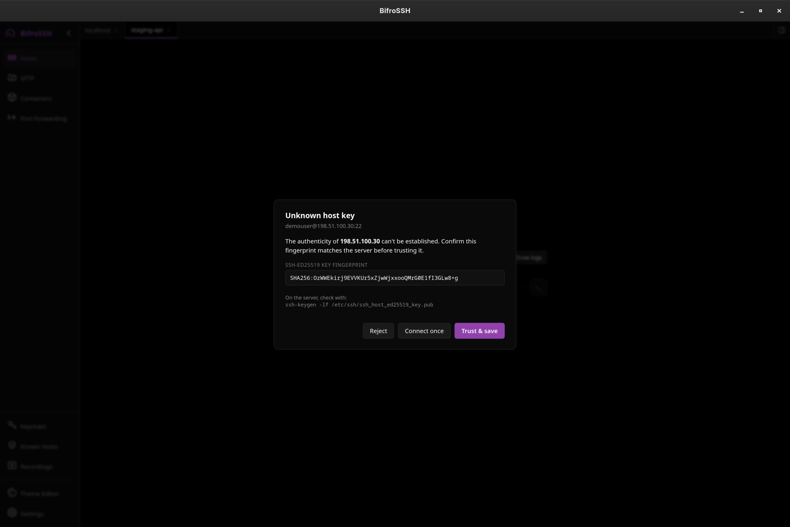

Trusted keys live in BifroSSH's own `known_hosts`, in standard OpenSSH format, alongside the rest of its data: `~/.local/share/bifrossh` on Linux and `%APPDATA%\BifroSSH` on Windows. Your OpenSSH `known_hosts` (`~/.ssh/known_hosts`, or `%USERPROFILE%\.ssh\known_hosts`) is also read, so anything you have already connected to from a terminal never prompts. That file is only ever read, never modified. The Known Hosts panel lists both, and forgets BifroSSH's own entries on request.

**Everything saved is encrypted** with a single master key. The whole of `data.json` is encrypted rather than just the credentials, so hostnames, usernames, jump chains, forwarding rules and saved commands are not left in the clear either.

On first launch you choose where that master key lives, and can change it later in Settings:

- **The system keyring, with a passphrase to fall back on.** Unlocks without asking. On Linux that is the desktop keyring, through the Secret portal inside Flatpak and the Secret Service outside it. On Windows it is DPAPI, which seals a key against your Windows account: the sealed file is worthless to another account and on another machine. Either way the key is not usable from disk alone, and the passphrase means the keyring going missing cannot lock you out.
- **Passphrase only.** Asked at every launch. The key exists nowhere until you type it. The only option that protects your keys from something already running as your user, and the only one where forgetting the passphrase loses them.
- **A file, no passphrase.** Nothing to remember. The key sits beside your data, protected only by the permissions on it.

Settings always shows which of these is actually in use. Where a passphrase is wanted, a dice button generates an eight-word phrase from the [BIP-39](https://github.com/bitcoin/bips/blob/master/bip-0039.mediawiki) English list (88 bits, hashed with Argon2id); capitalisation and spacing are ignored when you type it back. A passphrase you write yourself is taken exactly as typed.

None of this defends against malware running as you while the app is unlocked, and neither platform offers a way to. What it buys is that copying your home directory no longer copies the key along with the data.

**Locking.** Ctrl+Shift+L closes the vault: the key is zeroed and dropped, and the master passphrase is needed to open it again. Settings can also lock after a period with no input from you (off unless you turn it on) and before the computer sleeps (on by default), so what is on screen when the lid opens is the unlock screen. Locking needs a passphrase to be set; with the keyring alone the vault would reopen itself. Terminal sessions and tunnels already open stay connected behind the lock, the same as a screen lock over a shell, since the key was used when they connected and is not what they run on.

How the data directory itself is protected differs. On Linux it and everything in it is `0700`/`0600`, set at creation rather than after, so no other account can read it. Windows has no equivalent and BifroSSH does not write an ACL of its own: `%APPDATA%\BifroSSH` inherits the permissions on your user profile, which keeps out other standard accounts but not an administrator.

---

## Build from source

### Linux

Package names below are Fedora's; adjust for your distro.

### 1. System dependencies (one-time)

```bash
sudo dnf install -y webkit2gtk4.1-devel javascriptcoregtk4.1-devel openssl-devel gtk3-devel \
  libappindicator-gtk3-devel librsvg2-devel curl file gcc
```

### 2. Rust (one-time)

```bash
curl --proto '=https' --tlsv1.2 -sSf https://sh.rustup.rs | sh
source "$HOME/.cargo/env"
```

### 3. Node.js (one-time)

```bash
sudo dnf install -y nodejs npm
```

### 4. Clone and install

```bash
git clone https://github.com/AalmanSadath/BifroSSH.git
cd BifroSSH
npm install
./install.sh
```

### install.sh commands

| Command | Action |
|---|---|
| `./install.sh` | Build and install as native desktop app |
| `./install.sh uninstall` | Remove native desktop app |
| `./install.sh flatpak` | Build and install as Flatpak |
| `./install.sh uninstall-flatpak` | Remove Flatpak and local repo |
| `./install.sh clean` | Delete build artefacts (`dist/`, `src-tauri/target/`, `flatpak/.build/`, `flatpak/.repo/`) without touching the installed app |

### Windows

Needs [Rust](https://rustup.rs), [Node.js 22+](https://nodejs.org) and the Visual Studio Build Tools with the "Desktop development with C++" workload. Then:

```powershell
git clone https://github.com/AalmanSadath/BifroSSH.git
cd BifroSSH
npm install
npm run tauri -- build --bundles nsis
```

The installer lands in `src-tauri\target\release\bundle\nsis`. `npm run tauri -- dev` runs it without packaging. `install.sh` is Linux only.

---

## Build the Flatpak from source

### One-time setup

```bash
sudo dnf install flatpak-builder
flatpak install flathub org.gnome.Platform//50 org.gnome.Sdk//50
flatpak install flathub org.freedesktop.Sdk.Extension.rust-stable//25.08
flatpak install flathub org.freedesktop.Sdk.Extension.node22//25.08
```

### Build and install

```bash
./install.sh flatpak
flatpak run io.github.aalmansadath.bifrossh
```

The build runs entirely inside the sandbox with no network, so npm dependencies come from `flatpak/node-sources.json` and Cargo dependencies from `flatpak/cargo-sources.json`. Remove it again with `./install.sh uninstall-flatpak`.

---

## Development

```bash
npm install
npm run tauri dev
```

## License

[GPL-3.0-or-later](LICENSE): free to use, modify, and distribute; derivatives must also be open source under GPL-3.0 or later.

Bundled content written by other people, and the terms it comes under, is listed in [THIRD_PARTY.md](THIRD_PARTY.md).
